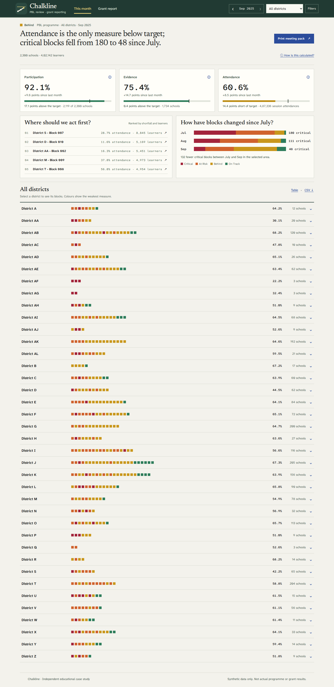

<p align="center"></p>

# Chalkline

[](https://github.com/ashh-droid/chalkline-pbl-review/actions/workflows/validate.yml)

**Mark where to act.** A programme review and grant-reporting workspace for project-based learning (PBL) data.

Chalkline presents monthly programme performance as a readable register rather than an administrative dashboard. It turns school response records into independently computed indicators, geographic priorities, meeting material and source-linked grant narratives.

**[Explore the interactive demo](https://ashh-droid.github.io/chalkline-pbl-review/)** · July–September 2025 · 2,300 schools · 38 districts · 395 blocks

> **Data provenance:** This is an independent technical demonstration built with synthetic educational, finance and media records supplied for a Mantra4Change engineering exercise. It is not a live programme, an official Mantra4Change product, or evidence of actual schools or grants.

## Quick start

**[Open the live demo](https://ashh-droid.github.io/chalkline-pbl-review/)** — no account or AI API key required.

```bash
npm install
npm test
npm start
```

The development app starts at `http://localhost:3000`. The tests automatically rebuild the TypeScript source first. The static production files live in `docs/`. Screenshots in `engineering/screenshots/` illustrate the original release and may not match subsequent improvements.



## The four views

| View | Purpose |
| --- | --- |
| **Program review** | Compare participation, evidence and session attendance; filter by month, district, block, grade and subject. Custom bullet charts, a 395-block progress matrix and a district attendance strip plot reveal where action is needed. |
| **Meeting pack** | A printable 35-minute review agenda covering achievements, month-to-month changes, risks, priority geographies and suggested owners/dates. Proposed actions are not confirmed assignments. |
| **Grant reporting** | Independently recompute grant indicators, reconcile finance data and milestones, inspect indexed synthetic media, and generate a cited narrative linked to fact IDs. |
| **Data notes** | Show formulas, assumptions, source inconsistencies and the limits of the dataset. |

## Decisions come from code

All performance metrics, classifications and finance checks are computed by deterministic code. The optional AI path can only word already computed facts; it cannot alter a count, target or grant status. Grant narratives are fully available with AI turned off, including on GitHub Pages.

| Indicator | Computation |
| --- | --- |
| Participation | Schools reporting that PBL was conducted ÷ eligible schools. For filtered grade/subject views, positive session attendance is used as a documented proxy because survey responses conflict with recorded sessions. |
| Evidence | Schools with evidence recorded ÷ eligible schools. |
| Session attendance | Recorded class-and-subject attendances ÷ (enrollment in selected classes × number of selected subjects). Both Math and Science together create two attendance opportunities per learner. |
| Month-over-month | Change in percentage **points**, not relative percentage growth. |
| Geographic status | Worst of participation, evidence and attendance. |
| Priority | Gap below target on the weakest indicator × selected enrollment ÷ 100. |

Risk thresholds are defined once in [`src/config/thresholds.ts`](src/config/thresholds.ts): **On Track ≥75%**, **Behind 60–74.9%**, **At Risk 35–59.9%**, **Critical below 35%**. No valid denominator is reported as No Data.

### Evidence-led grant reporting

Grant data is joined to the underlying school records by reporting month and covered districts. School counts, PBL completion, evidence, enrollment and attendance are independently recalculated and reconciled against the supplied summary for all **nine grant-month combinations**. Report sentences cite computed facts using `[F1]`–`[F13]`, with an adjacent fact ledger. Indexed synthetic evidence appears only for its applicable grant and month.

The application never presents the provided draft donor prose as verified fact, and it does not assume a financial currency where the source gives only budget units. September's remaining budget represents the fraction **not reported as utilized**, rather than proof of actual underspend.

## Data quality is visible

The source is retained without silent correction. The import audit reports:

| Finding | Observed records |
| --- | ---: |
| Grade survey responses inconsistent with attendance cells | 1,858 |
| Subject survey responses inconsistent with attendance cells | 1,669 |
| Finance utilization-rate discrepancies greater than 0.1 percentage points | 37 of 45 |
| Reported cumulative spend inconsistent with historical monthly spending | 4 |

These counts reflect the respective checks; overlaps between issue categories are possible. Only indexed, explicitly synthetic images are shown as supporting media.

## Technical architecture

```text
Original synthetic CSVs and media
            ↓
Python standard-library normalization + source-quality audit
            ↓
Normalized JSON + indexed synthetic media
            ↓
Pure TypeScript metrics, risk, review and grant modules
            ↓
Chalkline browser interface (static-first)
            └─ Optional Node narrative API → validated AI wording or deterministic fallback
```

The interface uses browser-native TypeScript, SVG and CSS. No runtime framework, external chart service or analytics tracker is required. Font files are planned for local hosting under `docs/fonts/`; the interface includes fallback system fonts. A Node server is included for local/API use; the published GitHub Pages edition is fully static and keeps all factual reporting functional.

### Reproducible builds

Node.js 20+ and npm are required for development. The `docs/` directory already contains the compiled static application and source data, so the demo does not require a database or AI credentials.

```bash
npm install
npm test
npm run typecheck
npm run build
npm start
```

The local web server serves the application at `http://localhost:3000`. `npm run import` regenerates the normalized JSON from the synthetic source CSVs. To examine the compiled site with any static server, serve `docs/` as the document root rather than opening `index.html` through `file://`.

The TypeScript modules are divided into [`core.ts`](src/core.ts), [`grant.ts`](src/grant.ts), [`review.ts`](src/review.ts), [`narrative.ts`](src/narrative.ts) and view components in [`src/pages`](src/pages). The original source CSVs are kept under `original_data/` for traceability; `docs/data/` holds prepared browser JSON rather than duplicate raw CSVs. `schools-lite.json` is generated from the full `schools.json` through `npm run build:data` and preserves the numeric inputs used by all indicator calculations.

The optional browser check `scripts/browser_smoke.py` requires Python 3, Playwright (`pip install playwright`) and installed Chromium browser binaries (`python -m playwright install chromium`). It is separate from the Node unit-test suite.

### Optional AI boundaries

The Node API optionally accepts an OpenAI-compatible narrative service through server-side `NARRATIVE_API_URL`, `NARRATIVE_API_KEY` and `NARRATIVE_MODEL` variables. The model receives only the computed fact list. Its output must pass citation and number checks; otherwise the deterministic narrative is displayed. The checks are structural and numerical, **not a guarantee of semantic truth**. No LLM key is included in the repository or needed for the GitHub Pages site. On GitHub Pages, optional AI wording is not connected; deterministic reports remain fully available.

## Data model

| Entity | Key fields and relationships |
| --- | --- |
| School | School ID, school name, district, block. One school has monthly responses. |
| Monthly PBL response | School ID, reporting month, conducted-PBL flag, submitted-evidence flag, source-rate/status fields; one record per school and month. |
| Class/subject session | Class 6–8, enrolled learners, Science attendance and Math attendance, nested in the monthly school response. |
| Grant | Grant ID/name, covered districts, reporting month, start/end period, source performance totals and milestone narrative. |
| Finance line | Grant ID, budget line, period/month, approved units, monthly units, reported cumulative units and source utilization rate. |
| Milestone | Recorded title, owner and completion status, parsed from the grant profile's milestone summary; not a separately maintained workflow record. |
| Media/evidence | Media record ID, grant ID, reporting month, district, title, file URL and caption; only indexed synthetic items appear. |

The browser works with prepared JSON; the original CSV exports remain available for audits. The smaller `schools-lite.json` carries only the month, block, boolean flags, and enrollment/attendance counts required for the front-end calculations.

## How this meets the brief

| Tier | Requirement | Where it is implemented |
| --- | --- | --- |
| Tier 1 | Month/district/block/class/subject filtering, shareable context | Filter controls and URL parameters in `src/ui.ts` |
| Tier 1 | KPIs, month-to-month context, status and geographic comparisons | Bullet chart, district/block register and attendance plot in `src/pages/program-chalk.ts` |
| Tier 1 | Sortable complete district/block reporting and strongest/weakest geographies | Performance table and prioritization based on `src/core.ts` |
| Tier 1 | Coded risk policy and explainable prioritization | `src/config/thresholds.ts`, `risk()` and `geography()` |
| Tier 1 | Grant assistant, facts and finance reconciliation | `src/grant.ts`, `src/pages/grant-panel.ts`, fact ledger and indexed media |
| Tier 2 | Monthly review summary; copy/export/print | `src/review.ts`, meeting pack and Markdown/print controls |
| Tier 3 | Suggested next actions with owner, priority, due date and linked metric | `generateReviewActions()` and the printable meeting pack |

AI does not determine numerical metrics, risk levels, source mismatches, or proposed numerical priorities.

## Live review: common changes

| Change | Entry point |
| --- | --- |
| Adjust the On Track cutoff | `src/config/thresholds.ts` — `THRESHOLDS.ON_TRACK` |
| Add or modify a KPI | `src/core.ts` (`Metrics` and `calcMetrics()`), then `src/pages/program-chalk.ts` |
| Change source-risk interpretation | `risk()` in `src/core.ts`, and corresponding tests |
| Edit report wording without changing facts | `src/grant.ts` and `src/pages/grant-panel.ts` |
| Adjust the action rules or due dates | `src/review.ts` |
| Change filter UI or navigation | `src/ui.ts` |
| Refresh source data | `scripts/import_data.py`, then `npm run build:data` and `npm test` |

`npm test` rebuilds before testing; the committed `docs/app/` files are the browser artefacts, while `src/` is the maintained source. `npm run format` applies Prettier to source files.

## Responsible AI-assisted development

ChatGPT-assisted suggestions were used for aspects of code drafting, copy, review and test ideas. Generated suggestions were assessed against the supplied synthetic records and the deterministic calculation requirements rather than accepted as authoritative evidence. Numeric outputs are backed by pure source-controlled functions and unit tests. Grant claims cite specific fact IDs; any optional model-authored text must pass number and citation checks, with a deterministic fallback.

The source data and media are identified as synthetic. The project is independently authored for an engineering exercise and is not an official programme product. This README does not claim an AI-generated narrative is factually correct merely because its numerical validation succeeds.

## Production plan

A deployable multi-user service would replace the static dataset with a relational database (schools, responses, sessions, grants, finance lines, milestones and media, with immutable import and review history). Scheduled versioned imports would validate file schemas, duplicate school/month keys, denominator integrity, finance reconciliation and source provenance before publication. Role-based authentication would separate programme readers, editors, grant reviewers and administrators.

Aggregate query caching and partial/paginated record delivery would keep dashboard responses small. Monitoring would cover import failures, request latency, data freshness, audit trails, error reports and accessibility/performance budgets. Secure handling, permissioned evidence access, retention rules and human review of any external reports are prerequisites for production.

## Future improvements

- Record-level drill-downs that load only the needed school records, without bulk first-load downloads.
- More accessible small-screen chart alternatives and print-ready evidence summaries.
- Scheduled source-quality monitoring and a visible data-freshness timestamp.
- Independent accessibility, performance and cross-device regression checks.
- Reviewer approval workflow with traceable edits and preserved report versions.

## Distribution

Source code is made available publicly for evaluation of this assessment project; no license to reuse, modify or redistribute the code is granted. The synthetic data and media remain subject to the assignment's original rights and provenance conditions. No real school programme or donor data is represented here.

## Validation and limitations

Automated tests cover attendance denominators, filters, risk boundaries, all grant/month reconciliations, finance discrepancies, priority actions, narrative rejection and source audits. The initial release passed 18 tests. The current suite includes an additional compact-source equivalence test. Use the linked GitHub Actions badge for the latest automated result instead of treating historical test counts as current. Detailed results and scope are recorded in [engineering/VERIFICATION.md](engineering/VERIFICATION.md).

This is a historical synthetic dataset, not a production backend. A field deployment would require source validation and approvals, role-based access, immutable audit history, consent and retention controls, proper financial reconciliation, and human review of narrative claims. The runtime AI connection has been tested for fallback behavior, not with a real provider API key.

---

*Chalkline is an independent educational programme analytics case study. All figures, entities and media are synthetic.*
